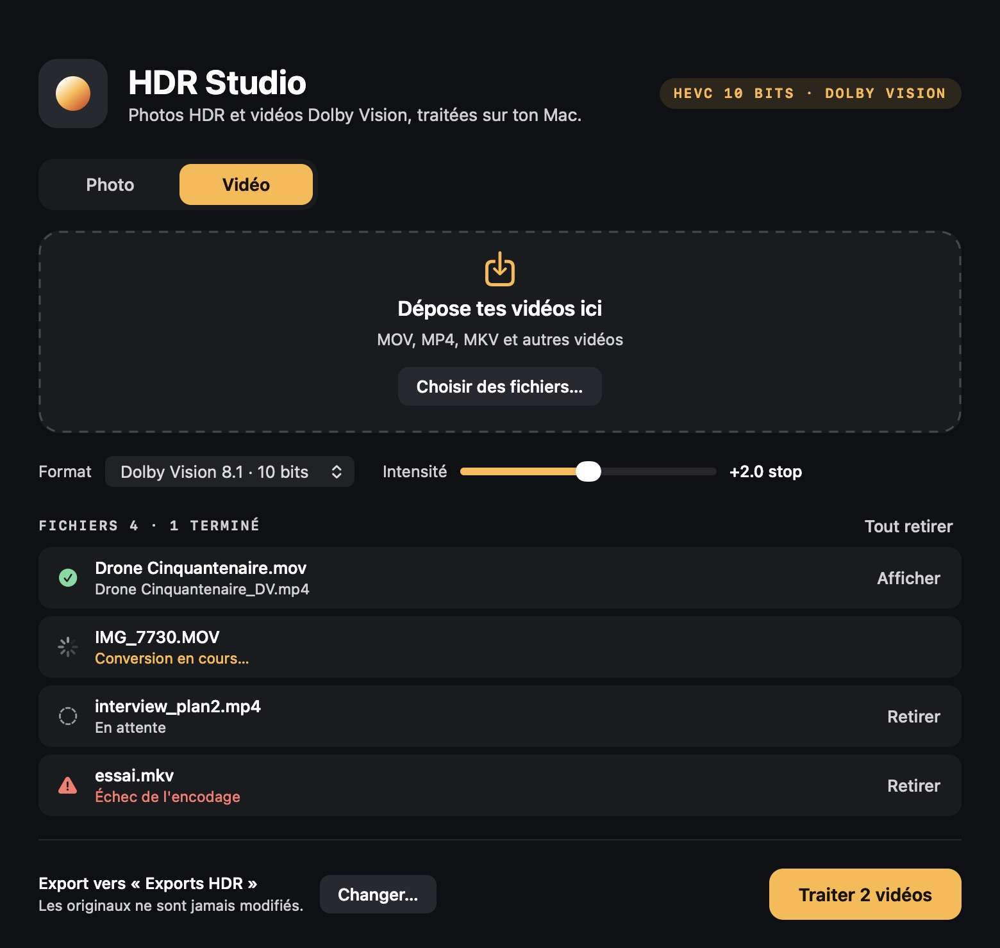

# HDR Studio

Application macOS qui exporte tes photos en **HEIC HDR (gain map)** et tes vidéos en
**HEVC 10 bits Dolby Vision 8.1** ou **HDR10**. Tout est traité sur le Mac.



## Installation

```sh
git clone -b claude https://github.com/renaud-bxl/hdr-studio.git
cd hdr-studio && ./install.sh
```

Le script installe au besoin `ffmpeg`, `dovi_tool` et `gpac` avec Homebrew, compile
l'application et dépose « HDR Studio Claude.app » sur le Bureau.

Prérequis : macOS 14 ou plus récent, [Homebrew](https://brew.sh), outils Xcode
(`xcode-select --install`).

La page de présentation est dans [`docs/index.html`](docs/index.html). Elle peut être
servie par GitHub Pages (dossier `/docs`) ou déposée telle quelle sur un hébergement web.

## Utilisation

1. Choisis l'onglet **Photo** ou **Vidéo**.
2. Dépose tes fichiers, ou clique sur **Choisir des fichiers…**
3. Règle l'intensité et, pour la vidéo, le format.
4. Clique sur **Traiter** et choisis le dossier d'export.

Les originaux ne sont jamais modifiés. Si un export du même nom existe, le nouveau reçoit un numéro.

## Formats

| Export | Fichier | Contenu |
|---|---|---|
| Photo HDR | `nom_HDR.heic` | Base Display P3 et gain map ISO 21496-1 |
| Dolby Vision | `nom_DV.mp4` | HEVC Main 10, BT.2020 PQ, HDR10, RPU Dolby Vision 8.1 |
| HDR10 | `nom_HDR10.mp4` | HEVC Main 10, BT.2020 PQ, HDR10 |

Rendu :

- **Photo** : en lumière linéaire, chaque canal suit `r + k·r³` avec `k = 2^stops − 1`.
  Les ombres et tons moyens restent en place, le blanc monte de la valeur du curseur.
- **Vidéo SDR** : linéarisation, passage BT.709 vers BT.2020, blanc de référence à 203 nits,
  puis rehaussement progressif jusqu'à `203 × 2^stops` nits (environ 810 nits à +2 stops).
- **Vidéo HLG** (iPhone) : conversion vers PQ pour un écran de 1000 nits.
- **Vidéo PQ** : le signal est conservé.

## Ligne de commande (facultatif)

L'application s'utilise par sa fenêtre. Ces commandes servent seulement à convertir sans l'ouvrir.
Ce sont des exemples : remplace les chemins par ceux de tes propres fichiers (tu peux glisser un
fichier du Finder dans le Terminal pour écrire son chemin).

```sh
APP="$HOME/Desktop/HDR Studio Claude.app/Contents/MacOS/HDRStudio"

# Photo : source, sortie, intensité en stops
"$APP" --convert-photo ~/Desktop/ma_photo.jpg ~/Desktop/ma_photo_HDR.heic 1.3

# Vidéo : source, sortie, format (dv ou hdr10), intensité en stops
"$APP" --convert-video ~/Desktop/ma_video.mov ~/Desktop/ma_video_DV.mp4 dv 2.0
```

Pour contrôler un export vidéo : `MP4Box -info ~/Desktop/ma_video_DV.mp4 | grep -i dolby`

## À savoir

- Une source SDR reste une source SDR : l'application rehausse les hautes lumières, elle ne
  recrée pas les détails perdus à la prise de vue.
- L'encodage vidéo (x265, 10 bits) est lent sur de la 4K.
- L'application est signée pour un usage local. Une diffusion publique demande un compte
  Apple Developer (signature et notarisation). Dolby Vision est une marque et un format de
  Dolby Laboratories ; son usage dans un produit diffusé peut demander un accord de licence.
